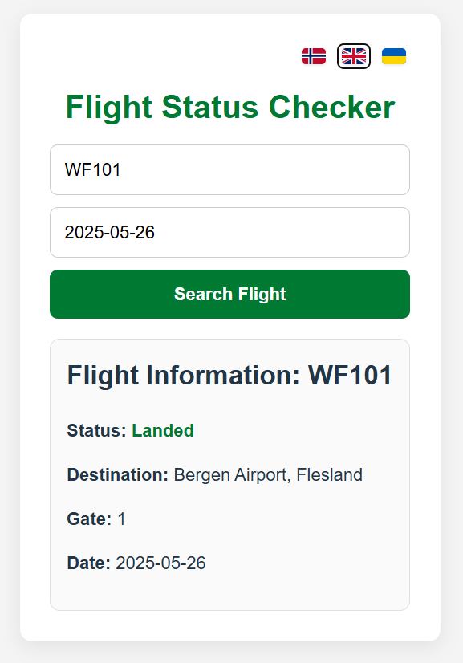

# ✈️ Flight Status Checker

A responsive, multilingual web app that allows users to check the status of any flight by its number and date. Built with React, it features internationalization, mobile-friendly calendar input, and real-time data via [aviationstack.com](https://aviationstack.com/).

**Live demo:** [flight-status-app-sigma.vercel.app](https://flight-status-app-sigma.vercel.app)



---

## 🔧 Tech Stack

- ⚛️ React + Vite
- 🌍 i18next (internationalization)
- 📅 react-datepicker (with localization)
- 🌐 aviationstack API
- 🎨 CSS3 + variables + media queries
- 📱 Fully responsive (mobile-first)

---

## 🚀 Features

- 🔍 Search for a flight by flight number and date
- 🗓 Interactive mobile-friendly calendar with automatic locale
- 🌐 Language switcher (🇳🇴 NO, 🇬🇧 EN, 🇺🇦 UA)
- 📡 aviationstack API through a server-side proxy
- ⚙️ Live deployment on Vercel
- 🔐 API key kept server-side in a Vercel function, never shipped to the browser

---

## 🛠 Installation

```bash
git clone https://github.com/your-username/flight-status-app.git
cd flight-status-app
npm install
```

## ⚙️ Environment Setup

The API key is used only by the serverless function in `api/flight.js`, so it never reaches the browser.
Copy `.env.example` to `.env` and add your aviationstack key:
```bash
AVIATIONSTACK_KEY=your_api_key_here
```

## 🧪 Run Locally
The `/api` route needs the Vercel runtime, so run the app with the Vercel CLI:
```bash
npx vercel dev
```

## 🌍 Deployment
Deployed on Vercel (the `/api` function needs it)

* Push your project to GitHub.
* Link the repo in Vercel.
* Add `AVIATIONSTACK_KEY` in Settings → Environment Variables.

## 📁 Project Structure
```bash
├── api/flight.js                  # Serverless function, holds the API key
├── src/
│   ├── api/aviationAPI.js         # Calls /api/flight
│   ├── component/PlaneSpinner.jsx # Loading animation
│   ├── i18n/                      # Translations
│   ├── App.jsx                    # Main app component
│   └── App.css                    # Mobile-first responsive styles
├── .env.example                   # Template for local secrets
├── index.html
└── README.md
```

## 🌐 Example Usage
1. Enter a flight number in IATA format (e.g. `DY372`)
2. Select the date (default is today)
3. Click **Search Flight**

The app returns:

* Flight status (scheduled, active, landed, cancelled, diverted)
* Destination airport
* Departure gate
* Date of departure

## ✅ How to test with Flightradar24

The app uses aviationstack's **real-time** data, so the easiest test is a flight that is in the air right now.

1. Open [flightradar24.com](https://www.flightradar24.com) and click any aircraft on the map, for example over Norway.
2. Copy the flight number from the panel on the left (e.g. `DY372`, Norwegian, Oslo → Tromsø).
3. Open the [live demo](https://flight-status-app-sigma.vercel.app), paste the flight number, keep today's date and click **Search Flight**.
4. Compare the result with Flightradar24: the status should be `active` and the destination should match.

**Check the API directly.** The serverless function can be called without the UI:

```
https://flight-status-app-sigma.vercel.app/api/flight?flight_iata=DY372
```

The response contains `data`, `pagination` and `error`:

| Response | Meaning |
|---|---|
| `"total": 0`, `"error": null` | The key works, but aviationstack has no real-time record for this flight. Try a flight that is flying now. |
| `"error": { "code": ... }` | The provider rejected the request, e.g. the monthly limit of the free plan is used up. |
| `400 Invalid flight number` | The input is not a valid IATA flight number (two characters + 1–4 digits). |

Future dates usually return no result, because the app only looks up real-time flights.

## 🔐 Security note

An early version of this app committed `.env` and read the key with `VITE_API_KEY`. Vite inlines every `VITE_` variable into the client bundle, so the key was public twice: in Git history and in the deployed JavaScript. The old key is no longer used by the app, `.env` is now ignored, and the request goes through a serverless function that validates the flight number and keeps the key on the server.

## 📄 License
MIT © 2025 [@tobolovskaya](https://github.com/tobolovskaya)
